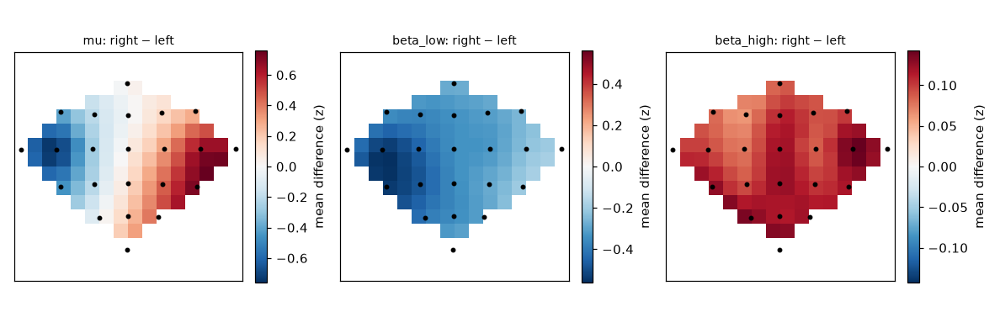
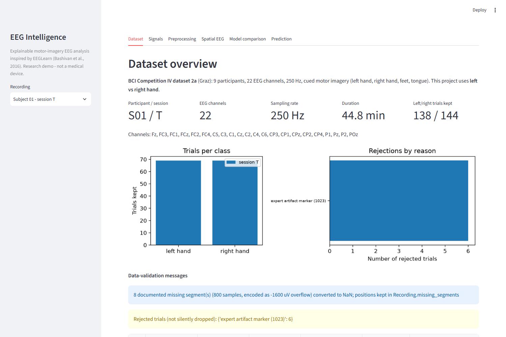
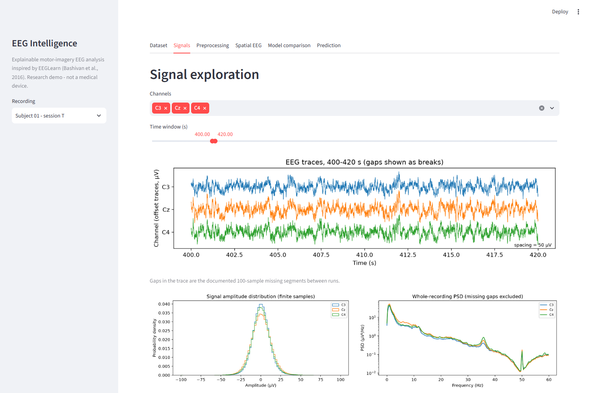
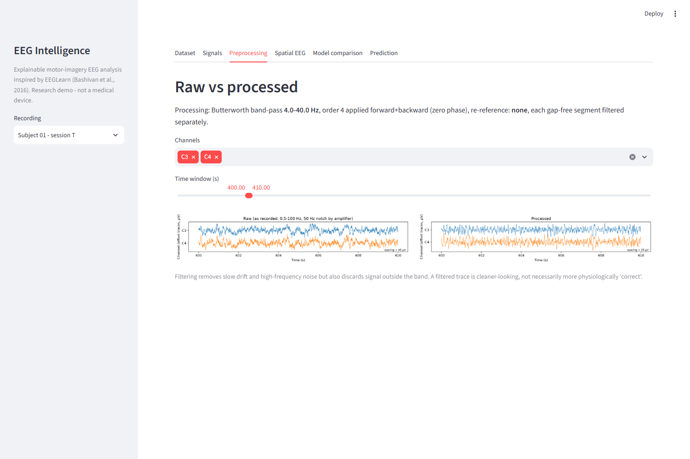
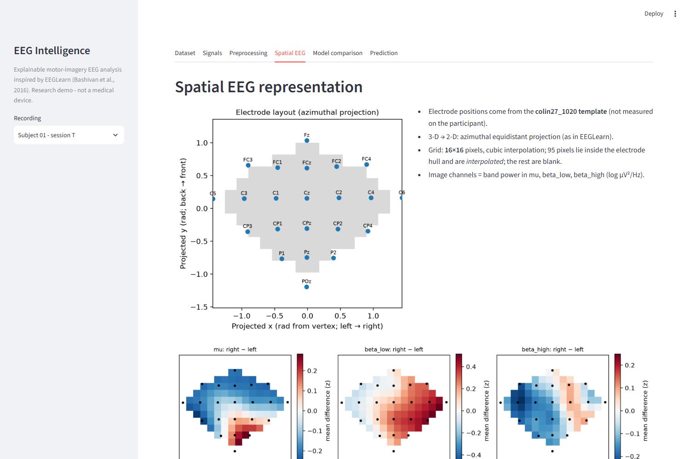
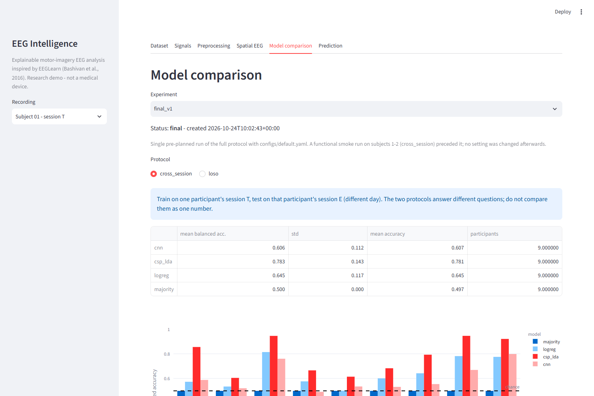
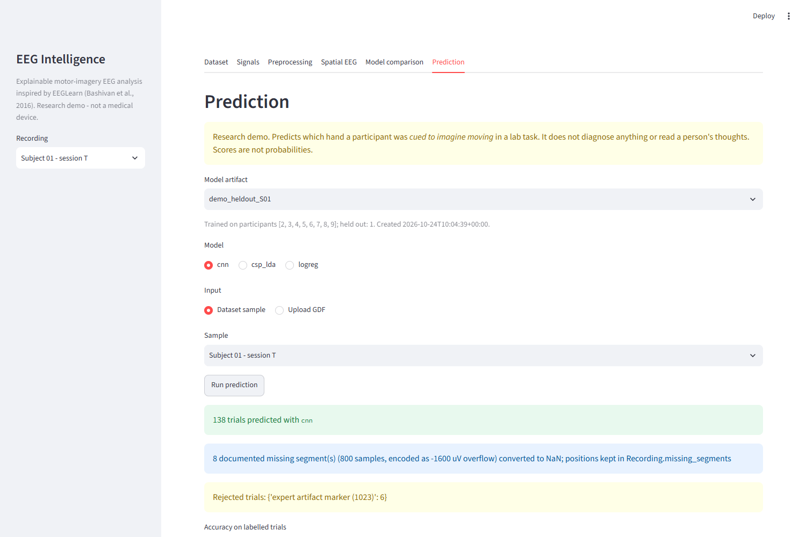

# EEG Intelligence — explainable motor-imagery EEG analysis

A from-scratch, leakage-aware EEG pipeline for **left-hand vs right-hand motor imagery**, inspired by the *EEG images* idea of
Bashivan et al., *Learning Representations from EEG with Deep Recurrent-Convolutional Neural Networks* (ICLR 2016) and its
reference code [EEGLearn](https://github.com/pbashivan/EEGLearn). Built on real data (BCI Competition IV 2a), with classical baselines, a
PyTorch CNN, subject-wise evaluation, tests, and a Streamlit dashboard.

> **Research / education demo.** Not a medical device. It does not diagnose anything or read anyone's thoughts. Please read
> [docs/LIMITATIONS.md](docs/LIMITATIONS.md) before quoting any number.

> **Research audit (2026-10-24):** the results below were independently reproduced bit-for-bit, a runtime leakage audit found no leakage, and additional controls/experiments are in
> [docs/RESEARCH_AUDIT.md](docs/RESEARCH_AUDIT.md). Notable: ocular/gaze information may contribute for some participants; the S08 outlier is real but unexplained;
> alignment-based adaptation helps cross-participant CSP + LDA (0.730) but needs unlabeled target data (not zero-shot).

> **Ocular-robust evaluation and pre-cue investigation** ([docs/OCULAR_ROBUST_EVALUATION.md](docs/OCULAR_ROBUST_EVALUATION.md)): EOG-only decoding is above chance, but frontal-channel exclusion and EOG regression do not change CSP + LDA;
> the pre-cue control score is mostly explained by carry-over from the previous trial plus the negatively dependent cue order (only 4 distinct cue sequences exist in the 18 recordings); a ≈ 0.03 residual in protocol A is unresolved.

## Headline result (honest version)

Balanced accuracy, mean ± SD over the 9 participants of BCI IV 2a, run `final_v1` ([full tables](docs/EXPERIMENTS.md)):

| Protocol | Majority (floor) | Band power + LogReg | **CSP + LDA** | Spatial-image CNN |
|---|---|---|---|---|
| **A.** Same participant, unseen session (train T → test E) | 0.500 | 0.645 ± 0.117 | **0.783 ± 0.143** | 0.606 ± 0.112 |
| **B.** Unseen participant (leave-one-subject-out) | 0.500 | 0.575 ± 0.054 | **0.632 ± 0.150** | 0.545 ± 0.042 |

* The classical CSP + LDA baseline beat the CNN under both protocols. **The CNN is not claimed to be better.**
* The two protocols answer different questions and must not be mixed. Protocol B is weak: the CSP + LDA mean is carried by one participant (S08: 0.955; others average 0.59).
* Nine participants, ~110–280 test trials each: expect wide uncertainty. No comparison with published results is made.

## What is reused from EEGLearn, and what is new

| | |
|---|---|
| **Reused conceptually** | band power per electrode → place on 2-D scalp map via azimuthal equidistant projection → cubic interpolation → stack bands as image channels → CNN; VGG-style 3×3 convolutions, dropout, Adam, L2; leave-subject-out thinking |
| **Re-implemented** (no EEGLearn code copied; EEGLearn is GPL-2.0) | everything, in NumPy/SciPy/MNE/scikit-learn/PyTorch; interpolation as a precomputed matrix; training-only image normalisation; isotropic grid + fitted sphere centre; hull mask |
| **New** | raw-EEG pipeline (GDF loading, gap handling, filtering, event-aligned epoching, rejection log), CSP + LDA and band-power baselines, subject-pure splits with overlap assertions, metrics with undefined cases, hash-checked model artifacts, dashboard, 183 tests |
| **Not done** | EEGLearn's recurrent/multi-window models; reproduction of the paper's results (different data, task and protocol); ICA artifact removal; real-time operation |

The analysis of the original code (data format, `gen_images`, pipeline, defects such as the subject-dependent validation split and the
Theano/Lasagne/Python-2 dependencies) is in [docs/ORIGINAL_EEGLEARN_ANALYSIS.md](docs/ORIGINAL_EEGLEARN_ANALYSIS.md).

## Task and data

* **Task:** cued imagery of left vs right hand (classes 1/2 of BCI Competition IV 2a; feet/tongue excluded and counted).
* **Data:** 9 participants × 2 sessions (T with labels, E evaluated with the official true labels), 22 EEG channels, 250 Hz, 288 trials/session.
  Source, terms, checksums, verified facts and caveats (e.g. only 5 of 22 channel names are in the files): [docs/DATASET.md](docs/DATASET.md).
  The data are **not** in this repository.

## Pipeline

1. **Load & validate** GDF (22 EEG channels, µV); the 100-sample between-run gaps (stored as −1600 µV) become NaN and are reported, never filled.
2. **Filter** 4–40 Hz (CSP: 8–30 Hz) zero-phase Butterworth on each gap-free segment.
3. **Epoch** 0.5–2.5 s after cue onset; reject expert-marked / > 200 µV / gap-overlapping trials *with recorded reasons*.
4. **Features:** log mean PSD in mu (8–12), low beta (13–20), high beta (21–30) Hz per channel.
5. **Spatial images:** template 10-20 positions → azimuthal projection → 16×16 grid, cubic interpolation, per-band z-score fitted on training data only.
6. **Models:** majority class, band-power logistic regression, CSP + LDA, compact CNN (89.5 k parameters).
7. **Evaluate** with protocol A and B, saved with config, versions, split manifests and rejected trials in `outputs/final_v1/`.

Details and the leakage-safeguard table: [docs/METHODOLOGY.md](docs/METHODOLOGY.md); module map and data flow: [docs/ARCHITECTURE.md](docs/ARCHITECTURE.md).



*Mean right − left log band power for participant 3 (z-scored for display). Interpolated between electrode positions (black dots; template positions, not measured).
Mu power is lower over the left sensorimotor area and higher over the right for right-hand imagery — the expected contralateral pattern, and a sanity check on label and layout orientation.*

## Screenshots of the dashboard

Captured from the running Streamlit app (`streamlit run app.py`) on the real BCI Competition IV 2a data (participant 1, session T unless stated).

**1. Dataset overview** - participant, channels, sampling rate, trial counts per class, rejected trials with reasons, and data-validation messages (the documented between-run gaps are reported, never silently filled).



**2. Signal exploration** - EEG traces of selected channels and time window, amplitude distribution and power spectral density.



**3. Raw vs processed** - the same segment before and after the documented zero-phase 4-40 Hz band-pass.



**4. Spatial EEG** - electrode layout (template positions, azimuthal projection), the interpolated 16x16 grid and right-minus-left band-power maps. Every coloured pixel is interpolated.



**5. Model comparison** - saved experiment results per participant for the majority baseline, band-power logistic regression, CSP + LDA and the CNN, with the evaluation protocol stated.



**6. Prediction** - a model trained without participant 1 predicts a recording through the same validated pipeline as the command line; scores are not probabilities and the page states that this is a research demo.



## Install

Python 3.10+ declared; developed and tested only on Python 3.11.9, Windows 11, CPU.

```bash
python -m venv .venv
.venv\Scripts\activate            # Linux/macOS: source .venv/bin/activate
pip install --index-url https://download.pytorch.org/whl/cpu "torch>=2.2"
pip install numpy scipy pandas mne scikit-learn matplotlib plotly streamlit pyyaml pytest
# or: pip install -r requirements.txt  (installs the default torch build)
```

Tested versions: numpy 2.4.6, scipy 1.17.1, pandas 3.1.0, mne 1.13.2, scikit-learn 1.9.1, torch 2.14.1+cpu, streamlit 1.66.1, plotly 7.1.0, pytest 9.1.1.
Then download the data as described in [data/README.md](data/README.md) / [docs/DATASET.md](docs/DATASET.md). Theano/Lasagne are *not* used.

## Use

```bash
python -m pytest                                                     # 183 tests (5 need the real data)

# train + evaluate (several minutes on CPU): writes outputs/<name>/
python -m src.training.train evaluate --protocol cross_session loso --name final_v1 --status final
python scripts/make_experiment_report.py final_v1                      # regenerates docs/EXPERIMENTS.md

# export a model trained without participant 1, then predict participant 1's evaluation session
python -m src.training.train export-demo --heldout 1
python -m src.training.predict --artifact models/demo_heldout_S01 --file data/raw/bci_iv_2a/A01E.gdf \
       --labels data/raw/labels_2a/A01E.mat --model csp_lda

streamlit run app.py                                                  # dashboard
```

Dashboard tabs: dataset overview · signal exploration · raw vs processed · spatial EEG maps (interpolated vs electrode positions) · model comparison
(per participant, confusion matrices, protocol text) · prediction (dataset sample or validated GDF upload).
All settings live in [configs/default.yaml](configs/default.yaml). Notebooks in `notebooks/` walk through exploration, preprocessing, features and results.

## Verification status

| Component | Status |
|---|---|
| Loader, validation, preprocessing, epoching, features, spatial maps, models, splits, metrics, prediction | implemented, **tested** (183 passed, 0 failed, 0 skipped — see [docs/TESTING.md](docs/TESTING.md)); leakage audited at run time ([docs/RESEARCH_AUDIT.md](docs/RESEARCH_AUDIT.md)) |
| Real dataset | **downloaded and loaded**; full evaluation run (`final_v1`) |
| Dashboard | implemented; **smoke-tested headlessly** (Streamlit `AppTest`), not in a browser |
| Notebooks | code cells executed once via script; not run through Jupyter |
| Dockerfile | written, **not built or run** (Docker not available here) |
| ICA / causal filtering / EEGLearn recurrent models / calibrated probabilities | not implemented |

## Known limitations (short)

Nine participants; cued labels; template electrode positions and 17 of 22 channel names inferred from the official figure's geometry; possible ocular contribution; minimal artifact handling; offline non-causal filtering; public test labels;
weak unseen-participant generalisation; scores are not probabilities. Full list: [docs/LIMITATIONS.md](docs/LIMITATIONS.md), model details: [docs/MODEL_CARD.md](docs/MODEL_CARD.md).

## References

* Bashivan, Rish, Yeasin, Codella (2016). *Learning Representations from EEG with Deep Recurrent-Convolutional Neural Networks.* ICLR. arXiv:1511.06448
* Brunner, Leeb, Müller-Putz, Schlögl, Pfurtscheller. *BCI Competition 2008 – Graz data set A.* Graz University of Technology (official description).
* Ramoser, Müller-Gerking, Pfurtscheller (2000). Optimal spatial filtering of single trial EEG during imagined hand movement. *IEEE Trans. Rehab. Eng.* 8(4) *(cited from memory; verify)*.
* Pfurtscheller, Lopes da Silva (1999). Event-related EEG/MEG synchronization and desynchronization. *Clin. Neurophysiol.* 110 *(cited from memory; verify)*.
* Gramfort et al. MNE-Python; Pedregosa et al. scikit-learn; Paszke et al. PyTorch; SciPy `griddata`.

## Licence and attribution

Project code: MIT ([LICENSE](LICENSE)) — covers only code written here. **EEGLearn** (GPL-2.0, © Pouya Bashivan) is only studied, never copied or imported (cloned separately under
`../reference/EEGLearn`). **BCI Competition IV data** belong to the Graz group and are subject to their attribution requirement; they are not redistributed. Third-party libraries keep their own licences.
